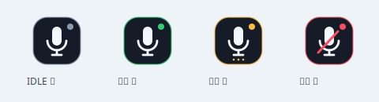

# 豆包语音输入（Linux 轻量版）

按住**右 Ctrl**说话，松开后把豆包识别结果粘贴到当前输入框。
无常驻窗口：**系统托盘图标**实时反馈状态，不反显识别文字。

> 本项目使用豆包网页登录凭证（非官方 API Key SDK），网页接口或凭证变化可能导致识别失败。实际语音会发往豆包服务器；`test-mic` 只测本地音量，不上传、不保存音频。

## 功能

- 后台服务收录音频，走豆包 WebSocket ASR，结果经剪贴板 + uinput 粘贴
- 托盘图标：待机灰 / 录音绿 / 处理黄 / 错误红
  - **左键点击** = 按下/松开右 Ctrl（点一下开始，再点一下结束）
  - **右键菜单** = 麦克风选择、快捷键选择（右 Ctrl / 右 Shift / 右 Alt）、登录、退出
- 登录按需进行：本地已有凭证时先询问"保持登录 / 退出登录"，不重复登录
- 托盘进程崩溃不影响语音核心；识别文本不进入图标与状态文件



## 目录结构

```
src/doubao_input/
├── __main__.py            # CLI 入口（serve/login/doctor/…）
├── service.py             # 核心后台服务（asyncio，不加载 GUI 库）
├── streaming.py           # 录音队列 → ASR 识别协程
├── feedback.py            # 服务 ↔ 托盘进程管道（状态下行 / 事件上行）
├── indicator.py           # 托盘图标进程（GTK3 StatusIcon / X11 浮标 / 通知）
├── indicator_art.py       # 图标矢量绘制（cairo）
├── login_app.py           # 按需登录进程（已登录先询问）
├── runtime.py             # 单实例锁与运行状态文件
├── doubao/                # 豆包协议层（WSS 客户端、配置、凭证存储）
│   ├── asr_client.py      #   WebSocket 协议细节（唯一依赖 websockets 处）
│   ├── audio_capture.py   #   sounddevice 录音
│   ├── config.py          #   常量与 XDG 配置路径
│   ├── login_window.py    #   WebKit 登录窗口与凭证提取
│   ├── params_store.py    #   asr_params.json 读写（0600，原子写入）
│   ├── app_state.py       #   登录状态枚举
│   └── host_tools.py      #   wl-copy / xclip 探测
├── trigger/evdev_ptt.py   # evdev 全局热键监听（可配置触发键）
├── inject/injector.py     # 剪贴板写入 + uinput 粘贴注入
└── login/resources/       # 登录页注入的 JS

tests/                     # 55 项离线单元测试；probe/ 为联调探针
packaging/                 # PyInstaller 入口、deb 构建、udev 规则
debian/                    # deb 打包描述
docs/                      # 设计说明
```

## 安装与编译

### 方式一：单文件二进制（推荐分发）

```bash
sudo apt install python3-dev build-essential libportaudio2   python3-gi python3-cairo python3-gi-cairo gir1.2-gtk-3.0   gir1.2-gtk-4.0 gir1.2-webkit-6.0 wl-clipboard xclip

uv venv --python /usr/bin/python3 --system-site-packages .venv
uv sync --locked

uv run --no-sync pyinstaller --noconfirm --onefile --name doubao-input \
  --paths src \
  --add-data "src/doubao_input/login/resources:doubao_input/login/resources" \
  --add-data "src/doubao_input/resources:doubao_input/resources" \
  --exclude-module gi --exclude-module Gtk --exclude-module cairo \
  --collect-all sounddevice --hidden-import optparse \
  packaging/binary_entry.py
# 产物：dist/doubao-input（约 13MB）
sudo install -m755 dist/doubao-input /usr/local/bin/doubao-input
```

GTK/Cairo/WebKit 来自系统包（冻结时排除，运行时经 `packaging/binary_entry.py`
追加系统 `dist-packages` 路径），其余 Python 依赖全部打进二进制。

### 方式二：从源码运行（开发调试用）

```bash
uv venv --python /usr/bin/python3 --system-site-packages .venv
uv sync --locked
uv run --no-sync python -m doubao_input serve    # 或 ./start.sh serve
```

### 方式三：deb 包

```bash
bash packaging/build-deb.sh          # 生成 doubao-input_*.deb；--install 顺带安装
```

postinst 只配置设备权限，不联网装包、不自动启动。

### 权限配置（三种方式都需要，一次性）

```bash
sudo groupadd -f input
sudo usermod -aG input "$(id -un)"
sudo install -m 0644 packaging/99-doubao-input-uinput.rules /etc/udev/rules.d/
sudo install -m 0644 packaging/doubao-input.conf /etc/modules-load.d/
sudo modprobe uinput
sudo udevadm control --reload-rules
sudo udevadm trigger --subsystem-match=misc --sysname-match=uinput
```

完成后**注销桌面再登录**，然后 `doubao-input doctor` 自检。

## 使用

```bash
doubao-input login     # 首次使用先登录；已登录会问你要不要退出重登
doubao-input doctor    # 检查权限、设备、剪贴板、凭证
doubao-input serve     # 启动服务（前台日志；托盘图标出现）
```

之后按住右 Ctrl 说话即可；或左键点托盘图标。右键托盘图标可换麦克风、
换快捷键（右 Ctrl / 右 Shift / 右 Alt，即改即用）、重新登录、退出。

**终端里也能直接粘贴**：终端把 Ctrl+V 当成 readline 的 `quoted-insert`
（插入字面字符），文字进不去。因此默认 `--paste-shortcut auto` 会在粘贴
前读取焦点窗口的 `WM_CLASS`，识别出终端就自动改用终端自己的快捷键
（多数是 Ctrl+Shift+V，xterm 系是 Shift+Insert），其它应用照常 Ctrl+V。
每次只多花约 3ms，且只在粘贴时执行一次，不影响录音和识别。

`doubao-input doctor` 会打印当前焦点窗口和将会使用的快捷键，便于自查。
纯 Wayland（无 XWayland）无法查询焦点窗口，会退回 Ctrl+V，此时需用
`--paste-shortcut` 手动指定。

| 命令 | 作用 |
|---|---|
| `serve` | 语音输入 + 托盘图标（默认命令） |
| `serve --indicator-style float` | 改用右下角浮标（录音时才出现） |
| `serve --no-indicator` | 完全无界面运行 |
| `serve --paste-shortcut ctrl-v` | 强制全部用 Ctrl+V（默认是 auto 自动判断） |
| `indicator-demo` | 预览灰/绿/黄/红图标，不录音不联网 |
| `login` | 登录 / 退出登录 |
| `status` / `doctor` | 状态与自检（不输出识别文本或 cookie） |
| `devices` / `set-device` | 列出麦克风 / 保存选择（也可托盘菜单切换） |
| `test-mic --seconds 3` | 本地音量测试，不上传音频 |
| `install-service` | 生成 systemd 用户服务（不自动启动） |

配置文件在 `~/.config/doubao-input/`：`asr_params.json`（凭证）、
`audio.json`（麦克风）、`trigger.json`（快捷键）。

### 开机自启

```bash
doubao-input install-service
systemctl --user import-environment DISPLAY XAUTHORITY WAYLAND_DISPLAY
systemctl --user daemon-reload
systemctl --user enable --now doubao-input.service

journalctl --user -u doubao-input.service -f     # 日志
systemctl --user stop doubao-input.service       # 停止
```

跑在用户会话里（语音输入必须能访问麦克风与剪贴板），不需要 root。

unit 使用 `WantedBy=default.target` 而不是 `graphical-session.target`：
Cinnamon、XFCE 等桌面从不激活后者，用它会导致开机不自启。

系统服务还有个容易踩的坑：systemd 用户服务启动时环境里通常**没有**
`DISPLAY`（桌面会话是之后才把变量导入用户管理器的，而进程环境是启动
瞬间的快照，不会自动更新），结果是托盘图标不显示、粘贴报
`Can't open display: (null)`。服务因此会在运行时用 `loginctl` 主动解析
显示会话并写回环境变量（`session_env.py`），无需你手动执行
`import-environment`；图标进程若因会话未就绪启动失败，会按退避策略
自动重试。

二进制建议放到稳定路径再注册服务，避免依赖仓库目录：

```bash
install -m755 dist/doubao-input ~/.local/bin/doubao-input   # 无需管理员
# 或全局安装：
sudo install -m755 dist/doubao-input /usr/local/bin/doubao-input
```

`install-service` 把当前可执行文件的绝对路径写进 unit；换位置后需先删除
`~/.config/systemd/user/doubao-input.service` 再重新生成。

## 测试

```bash
uv run --no-sync python -m unittest discover -s tests -p "test_*.py" -v
```

详细架构与验收清单见 [docs/lightweight.md](docs/lightweight.md)。
